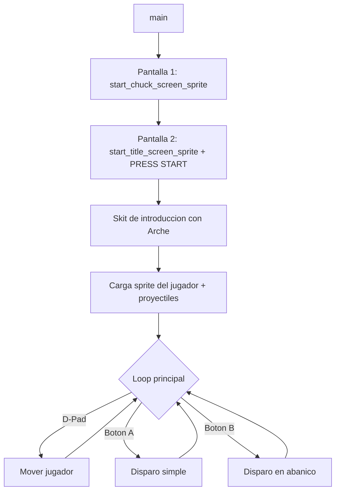

# Arche — Game Boy Game (GBDK)

Proyecto de un juego homebrew para **Nintendo Game Boy** desarrollado en C con **GBDK** (Game Boy Development Kit). El juego sigue a **Arche**, un personaje con disparos simples y en abanico ("spread"), presentado a través de una pantalla de título, un skit de diálogo inicial y (en progreso) niveles jugables con scroll de fondo.

> Estado general: **work in progress / prototipo**. La base técnica (sprites, animaciones, texto, disparo, movimiento) está implementada y funcionando; el contenido de niveles, mapas y enemigos está en construcción.

---

## Tabla de contenidos

- [Descripción del proyecto](#descripción-del-proyecto)
- [Funcionalidades implementadas](#funcionalidades-implementadas)
- [Work in progress / pendientes](#work-in-progress--pendientes)
- [Stack tecnológico](#stack-tecnológico)
- [Estructura del proyecto](#estructura-del-proyecto)
- [Setup del entorno](#setup-del-entorno)
- [Compilación y ejecución](#compilación-y-ejecución)
- [Flujo de arranque del juego](#flujo-de-arranque-del-juego)
- [Controles](#controles)
- [Notas técnicas](#notas-técnicas)

---

## Descripción del proyecto

**Arche GB** es un juego 2D de acción/disparos para Game Boy (DMG/CGB) escrito en C usando GBDK. El flujo actual arranca con dos pantallas de introducción a pantalla completa (128x128), continúa con un "skit" de diálogo animado del personaje, y desemboca en una escena de juego donde el jugador controla a Arche con el D-Pad y puede disparar proyectiles simples o en abanico.

El código fuente está organizado en módulos reutilizables dentro de `src/`, con [src/main.c](src/main.c) como punto de entrada. La raíz queda reservada para configuración, documentación, herramientas y la carpeta `build/` para los resultados de compilación.

## Funcionalidades implementadas

- **Pantallas de introducción**: carga y renderizado de pantallas completas de 128x128 píxeles (256 tiles), centradas o alineadas al borde inferior ([src/start/start_screen.h](src/start/start_screen.h)).
- **Pantalla de título con "PRESS START"**: sprite de texto animado de 64x16 px superpuesto sobre el fondo, con lógica para mostrar/ocultar.
- **Skit de introducción**: escena de diálogo con el personaje Arche animado (efecto "slide to center") y una caja de texto que espera input del jugador ([src/skits/skit_start.h](src/skits/skit_start.h)).
- **Sistema de texto / diálogo**:
  - Conversión de texto ASCII a tiles de fondo ([src/text/text.h](src/text/text.h)).
  - Caja de texto (text box) reutilizable ([src/text/text_box.h](src/text/text_box.h)).
  - Soporte para texto con formato tipo `printf` (parcialmente funcional, ver pendientes).
- **Generación y animación de sprites (metasprites)**:
  - Sprites compuestos de 16x16 (4 tiles), 32x32 (16 tiles) y 48x48 (36 tiles) px ([src/sprites/sprite_generate.h](src/sprites/sprite_generate.h)).
  - Tablas de offsets reutilizables para distintos tamaños de metasprite ([src/sprites/sprite_maps.h](src/sprites/sprite_maps.h)).
  - Animación de "levitación" y desplazamiento suave ("slide") hacia una posición objetivo ([src/animations/arche_big.h](src/animations/arche_big.h)).
- **Movimiento del jugador**: sprite de 16x16 controlado por el D-Pad con límites de pantalla (clamping) ([src/movement/sprite_movement.h](src/movement/sprite_movement.h)).
- **Sistema de disparo**:
  - Disparo simple con el botón A.
  - Disparo en abanico (3 proyectiles: recto, diagonal arriba, diagonal abajo) con el botón B y cooldown entre disparos ([src/actions/fire.h](src/actions/fire.h)).
- **Utilidades de limpieza de memoria**: ocultar sprites no usados/todos los sprites y limpiar VRAM (tiles y mapa de fondo) entre pantallas ([src/sprites/clean.h](src/sprites/clean.h)).
- **Entrada de usuario**: espera de pulsación de cualquier botón para avanzar de pantalla ([src/actions/input.h](src/actions/input.h)).
- **Pausa**: Start congela el juego y muestra el indicador «PAUSED»; otra pulsación reanuda ([src/ui/pause_overlay.h](src/ui/pause_overlay.h)).
- **Pipeline de assets gráficos**: script para convertir PNG a tiles de Game Boy con `rgbgfx` y volcarlos como array C con `xxd` ([tools/rgbgfx.bat](tools/rgbgfx.bat)).
- **Fondo del nivel 1**: nube gigante de primer plano (40x24 px) con silueta propia y nubes medianas/pequeñas espaciadas en el tilemap lejano. Las nubes avanzan hacia la izquierda a distintas velocidades, creando parallax ([src/maps/level_1_sky.h](src/maps/level_1_sky.h)).

## Work in progress / pendientes

- **Pantalla previa al nivel** (`load_level_start_screen`): implementada en [src/level_start/level_start_screen.h](src/level_start/level_start_screen.h) pero desactivada en `main()`. El `display_text_box` con argumentos `%s`/`%d` está marcado como no funcional ("no funciona con argumentos %s %d").
- **Enemigos**: no hay sprites, IA ni colisiones de enemigos todavía.
- **Colisiones**: no hay detección de colisiones entre proyectiles, jugador, enemigos o fondo.
- **Animación del personaje**: `arche_big.h` contiene animaciones de prueba (levitación, slide); falta un sistema de animación de sprite del jugador en gameplay (caminar, disparar, etc.).
- **Múltiples experimentos comentados**: varias funciones alternativas (versiones anteriores de `draw_press_start_sprite`, `move_16x16_sprite`, `move_row`, `move_metasprite_custom`, offsets de 80x16, etc.) quedaron comentadas como referencia/histórico y deberían limpiarse o eliminarse a medida que el diseño se estabilice.
- **Sistema de niveles**: solo existe un mapa de ejemplo (`level_1`); falta progresión entre niveles, condiciones de victoria/derrota y HUD (vidas, puntaje).
- **Sonido/música**: no implementado.
- **Guardado (SRAM)**: no implementado.

## Stack tecnológico

| Componente | Detalle |
|---|---|
| Lenguaje | C (ANSI C, estilo embebido con tipos `uint8_t`/`UINT8`/`INT8`) |
| SDK | [GBDK](https://gbdk.org/) (Game Boy Development Kit), usando las librerías `gb/gb.h`, `gb/cgb.h`, `gb/drawing.h`, `gb/metasprites.h` |
| Compilador | `lcc` (incluido en GBDK), invocado vía `make` |
| Build system | `make` con [makefile](makefile) propio (reglas `all`, `run`, `clean`) |
| Emulador de pruebas | [BGB](https://bgb.bircd.org/) |
| Conversión de gráficos | `rgbgfx` (parte de [RGBDS](https://rgbds.gbdev.io/)) + `xxd` para volcar binarios a arrays C ([tools/rgbgfx.bat](tools/rgbgfx.bat)) |
| Plataforma objetivo | Nintendo Game Boy / Game Boy Color (modo compatible, `gb/cgb.h`) |
| Artefactos de salida | ROM `build/arche.gb` y temporales `.ihx`, `.noi`, `.lst` dentro de `build/` |

## Estructura del proyecto

```
├── src/                        # Código fuente C y datos gráficos
│   ├── main.c                  # Punto de entrada y loop principal
│   ├── actions/                # Disparo e input
│   ├── animations/             # Animaciones
│   ├── level_start/            # Pantalla previa al nivel
│   ├── maps/                   # Mapas y fondos de niveles
│   ├── movement/               # Movimiento del jugador
│   ├── skits/                  # Escenas de diálogo
│   ├── sprites/                # Utilidades y datos gráficos por tipo
│   ├── start/                  # Pantallas de introducción
│   ├── text/                   # Texto y cajas de diálogo
│   └── ui/                     # Elementos de interfaz (pausa)
├── build/                      # ROM y temporales de compilación (ignorado por Git)
├── docs/                       # Notas del proyecto (notes.txt)
├── tools/                      # Scripts auxiliares (rgbgfx.bat, make_old.bat)
├── makefile                    # Build (all / run / clean) usando GBDK lcc
└── README.md
```

## Setup del entorno

### Requisitos previos

1. **GBDK** — SDK de desarrollo para Game Boy.
   - Descarga desde [gbdk.org](https://gbdk.org/) e instala (o descomprime) en una ruta local, por ejemplo `C:/GBDK`.
2. **RGBDS** (para `rgbgfx`) — utilidad para convertir imágenes PNG a formato de tiles de Game Boy.
    - Instálalo en `C:\RGBDS` (o ajusta la ruta en [tools/rgbgfx.bat](tools/rgbgfx.bat)).
3. **Vim (xxd)** o cualquier herramienta equivalente para volcar binarios a arrays C (`xxd -i`).
   - El script asume Vim instalado en `C:\Program Files\Vim\vim91\xxd.exe`.
4. **BGB** — emulador de Game Boy usado para probar la ROM.
   - Ajusta la ruta en la variable `BGB_PATH` del [makefile](makefile).
5. **make** disponible en el `PATH` (en Windows, puede venir con MSYS2, Git for Windows, o similar).

### Configuración de rutas

Antes de compilar, revisa y ajusta las rutas en el [makefile](makefile) según tu instalación local:

```make
GBDK_PATH = C:/GBDK
BGB_PATH  = "C:\ruta\a\bgb64.exe"
```

Y en [tools/rgbgfx.bat](tools/rgbgfx.bat) si necesitas regenerar gráficos:

```bat
"C:\RGBDS\rgbgfx" -o sprite.bin sprite.png
"C:\Program Files\Vim\vim91\xxd" -i sprite.bin > sprite.h
```

## Compilación y ejecución

Desde la raíz del proyecto (ver también [docs/notes.txt](docs/notes.txt)):

```powershell
# Compilar el proyecto (genera build/arche.gb)
make all

# Compilar y ejecutar directamente en BGB
make run all

# Limpiar todos los artefactos de compilación
make clean
```

El makefile define tres reglas principales:

- `all`: compila `src/main.c` a `build/main.o` y luego enlaza para producir `build/arche.gb`.
- `run`: ejecuta `all` y luego abre la ROM resultante en el emulador BGB.
- `clean`: elimina los archivos generados dentro de `build/`.

### Generar/actualizar gráficos de sprites

Para convertir un nuevo asset gráfico (PNG) a un header C con los tiles:

```powershell
.\tools\rgbgfx.bat
```

Esto genera `sprite.bin` (tiles en formato Game Boy) y `sprite.h` (array C listo para incluir), a partir de `sprite.png`.

## Flujo de arranque del juego



## Controles

| Botón | Acción |
|---|---|
| D-Pad | Mover a Arche (arriba/abajo/izquierda/derecha) |
| A | Disparo simple |
| B | Disparo en abanico (3 proyectiles) |
| Start | Pausar / reanudar el juego |
| Cualquier botón | Avanzar diálogos / pantallas de introducción |

## Notas técnicas

Cálculo de tiles por tamaño de sprite (referencia usada en el proyecto, ver [docs/notes.txt](docs/notes.txt)):

| Tamaño (px) | Píxeles | Tiles (8x8) |
|---|---|---|
| 8x8 | 64 | 1 |
| 8x16 | 128 | 2 |
| 16x16 | 256 | 4 |
| 32x32 | 1024 | 16 |
| 48x48 | 2304 | 36 |
| 64x16 | 1024 | 16 |
| 64x64 | 4096 | 64 |
| 80x16 | 1280 | 20 |
| 128x16 | 2048 | 32 |
| 128x128 | 16384 | 256 |
| 160x144 (pantalla completa) | 23040 | 360 |

- Las posiciones de sprites en Game Boy usan variables `volatile` para evitar que el compilador optimice de forma agresiva accesos que cambian por hardware/interrupciones.
- El límite de hardware es de 40 sprites simultáneos en pantalla; las utilidades en [src/sprites/clean.h](src/sprites/clean.h) ayudan a mantener este límite ocultando sprites no usados.
