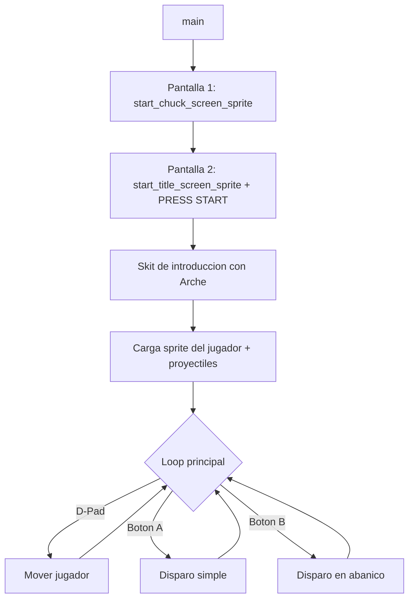

# Arche — Game Boy Game (GBDK)

Proyecto de un juego homebrew para **Nintendo Game Boy** desarrollado en C con **GBDK** (Game Boy Development Kit). El juego sigue a **Arche**, un personaje con disparos simples y en abanico ("spread"), presentado a través de una pantalla de título, un skit de diálogo inicial y (en progreso) niveles jugables con scroll de fondo.

> Estado general: **work in progress / prototipo**. La base técnica (sprites, animaciones, texto, disparo, movimiento) está implementada y funcionando; el contenido de niveles, mapas y enemigos está en construcción.

---

## Tabla de contenidos

- [Descripción del proyecto](#descripción-del-proyecto)
- [Funcionalidades implementadas](#funcionalidades-implementadas)
- [Work in progress / pendientes](#work-in-progress--pendientes)
- [Stack tecnológico](#stack-tecnológico)
- [Estructura del proyecto](#estructura-del-proyecto)
- [Setup del entorno](#setup-del-entorno)
- [Compilación y ejecución](#compilación-y-ejecución)
- [Flujo de arranque del juego](#flujo-de-arranque-del-juego)
- [Controles](#controles)
- [Notas técnicas](#notas-técnicas)

---

## Descripción del proyecto

**Arche GB** es un juego 2D de acción/disparos para Game Boy (DMG/CGB) escrito en C usando GBDK. El flujo actual arranca con dos pantallas de introducción a pantalla completa (128x128), continúa con un "skit" de diálogo animado del personaje, y desemboca en una escena de juego donde el jugador controla a Arche con el D-Pad y puede disparar proyectiles simples o en abanico.

El proyecto está organizado en módulos reutilizables (sprites, animaciones, movimiento, texto, mapas, acciones) que se combinan desde [main.c](main.c), favoreciendo la separación de responsabilidades pese a las limitaciones de un target embebido de 8 bits.

## Funcionalidades implementadas

- **Pantallas de introducción**: carga y renderizado de pantallas completas de 128x128 píxeles (256 tiles), centradas o alineadas al borde inferior ([start/start_screen.h](start/start_screen.h)).
- **Pantalla de título con "PRESS START"**: sprite de texto animado de 64x16 px superpuesto sobre el fondo, con lógica para mostrar/ocultar.
- **Skit de introducción**: escena de diálogo con el personaje Arche animado (efecto "slide to center") y una caja de texto que espera input del jugador ([skits/skit_start.h](skits/skit_start.h)).
- **Sistema de texto / diálogo**:
  - Conversión de texto ASCII a tiles de fondo ([text/text.h](text/text.h)).
  - Caja de texto (text box) reutilizable ([text/text_box.h](text/text_box.h)).
  - Soporte para texto con formato tipo `printf` (parcialmente funcional, ver pendientes).
- **Generación y animación de sprites (metasprites)**:
  - Sprites compuestos de 16x16 (4 tiles), 32x32 (16 tiles) y 48x48 (36 tiles) px ([sprites/sprite_generate.h](sprites/sprite_generate.h)).
  - Tablas de offsets reutilizables para distintos tamaños de metasprite ([sprites/sprite_maps.h](sprites/sprite_maps.h)).
  - Animación de "levitación" y desplazamiento suave ("slide") hacia una posición objetivo ([animations/arche_big.h](animations/arche_big.h)).
- **Movimiento del jugador**: sprite de 16x16 controlado por el D-Pad con límites de pantalla (clamping) ([movement/sprite_movement.h](movement/sprite_movement.h)).
- **Sistema de disparo**:
  - Disparo simple con el botón A.
  - Disparo en abanico (3 proyectiles: recto, diagonal arriba, diagonal abajo) con el botón B y cooldown entre disparos ([actions/fire.h](actions/fire.h)).
- **Utilidades de limpieza de memoria**: ocultar sprites no usados/todos los sprites y limpiar VRAM (tiles y mapa de fondo) entre pantallas ([sprites/clean.h](sprites/clean.h)).
- **Entrada de usuario**: espera de pulsación de cualquier botón para avanzar de pantalla ([actions/input.h](actions/input.h)).
- **Pipeline de assets gráficos**: script para convertir PNG a tiles de Game Boy con `rgbgfx` y volcarlos como array C con `xxd` ([rgbgfx.bat](rgbgfx.bat)).
- **Datos de nivel/tilemap iniciales**: mapa de fondo de ejemplo para el nivel 1 ([maps/level_1_map.h](maps/level_1_map.h)) y helper de carga de tilemaps con scroll horizontal automático ([maps/generate_map.h](maps/generate_map.h)).

## Work in progress / pendientes

- **Carga de fondo/tilemap del nivel**: `load_and_draw_background_foreground_map` y el scroll de background están implementados pero comentados en [main.c](main.c); el gameplay actual corre sin fondo de nivel.
- **Pantalla previa al nivel** (`load_level_start_screen`): implementada en [level_start/level_start_screen.h](level_start/level_start_screen.h) pero desactivada en `main()`. El `display_text_box` con argumentos `%s`/`%d` está marcado como no funcional ("no funciona con argumentos %s %d").
- **Enemigos**: la carpeta [sprites/enemies/](sprites/enemies) existe pero está vacía; no hay sprites, IA ni colisiones de enemigos todavía.
- **Colisiones**: no hay detección de colisiones entre proyectiles, jugador, enemigos o fondo.
- **Animación del personaje**: `arche_big.h` contiene animaciones de prueba (levitación, slide); falta un sistema de animación de sprite del jugador en gameplay (caminar, disparar, etc.).
- **Múltiples experimentos comentados**: varias funciones alternativas (versiones anteriores de `draw_press_start_sprite`, `move_16x16_sprite`, `move_row`, `move_metasprite_custom`, offsets de 80x16, etc.) quedaron comentadas como referencia/histórico y deberían limpiarse o eliminarse a medida que el diseño se estabilice.
- **Sistema de niveles**: solo existe un mapa de ejemplo (`level_1`); falta progresión entre niveles, condiciones de victoria/derrota y HUD (vidas, puntaje).
- **Sonido/música**: no implementado.
- **Guardado (SRAM)**: no implementado.

## Stack tecnológico

| Componente | Detalle |
|---|---|
| Lenguaje | C (ANSI C, estilo embebido con tipos `uint8_t`/`UINT8`/`INT8`) |
| SDK | [GBDK](https://gbdk.org/) (Game Boy Development Kit), usando las librerías `gb/gb.h`, `gb/cgb.h`, `gb/drawing.h`, `gb/metasprites.h` |
| Compilador | `lcc` (incluido en GBDK), invocado vía `make` |
| Build system | `make` con [makefile](makefile) propio (reglas `all`, `run`, `clean`) |
| Emulador de pruebas | [BGB](https://bgb.bircd.org/) |
| Conversión de gráficos | `rgbgfx` (parte de [RGBDS](https://rgbds.gbdev.io/)) + `xxd` para volcar binarios a arrays C ([rgbgfx.bat](rgbgfx.bat)) |
| Plataforma objetivo | Nintendo Game Boy / Game Boy Color (modo compatible, `gb/cgb.h`) |
| Artefactos de salida | ROM `.gb` ([arche.gb](arche.gb)), `.ihx`, `.noi`, `.lst` (listados de compilación/depuración) |

## Estructura del proyecto

```
├── main.c                     # Punto de entrada: loop principal del juego
├── makefile                   # Build (all / run / clean) usando GBDK lcc
├── rgbgfx.bat                 # Conversión PNG -> tiles GB -> array C (.h)
├── notes.txt                  # Notas rápidas de comandos y cálculo de tiles
│
├── actions/                   # Lógica de acciones del jugador
│   ├── fire.h                 #   Disparo simple y en abanico
│   └── input.h                #   Espera de input (avanzar pantallas)
│
├── animations/
│   └── arche_big.h            # Animaciones de metasprites (levitación, slide-to-center)
│
├── level_start/
│   └── level_start_screen.h   # Pantalla previa a un nivel (WIP, deshabilitada en main)
│
├── maps/
│   ├── generate_map.h         # Carga de tileset/tilemap y scroll de fondo
│   ├── level_1_map.h          # Datos de tilemap del nivel 1 (ejemplo)
│   └── tilemap_offsets.h      # Offsets auxiliares de tilemap
│
├── movement/
│   └── sprite_movement.h      # Movimiento del sprite del jugador (16x16) con límites
│
├── skits/
│   └── skit_start.h           # Escena de diálogo inicial (skit) con Arche
│
├── sprites/
│   ├── clean.h                 # Utilidades para ocultar sprites / limpiar VRAM
│   ├── sprite_generate.h       # Generación/carga de metasprites (16x16, 32x32, 48x48)
│   ├── sprite_maps.h           # Tablas de offsets de tiles por tamaño de metasprite
│   ├── arche/                  # Datos de sprite del personaje (grande/pequeño)
│   ├── effects/                # Sprites de efectos (p. ej. proyectiles)
│   ├── enemies/                # (vacío) Reservado para sprites de enemigos
│   ├── skits/                  # Sprites usados en el skit de introducción
│   ├── texts/                  # Sprites de texto (p. ej. "PRESS START")
│   ├── tilesets/                # Tilesets de fondo (p. ej. cielo nocturno con palmeras)
│   └── title_screen/            # Sprites de las pantallas de título
│
├── start/
│   └── start_screen.h          # Pantallas de introducción a pantalla completa
│
└── text/
    ├── text.h                  # Escritura de texto en el fondo, texto con printf
    └── text_box.h               # Caja de diálogo reutilizable
```

## Setup del entorno

### Requisitos previos

1. **GBDK** — SDK de desarrollo para Game Boy.
   - Descarga desde [gbdk.org](https://gbdk.org/) e instala (o descomprime) en una ruta local, por ejemplo `C:/GBDK`.
2. **RGBDS** (para `rgbgfx`) — utilidad para convertir imágenes PNG a formato de tiles de Game Boy.
   - Instálalo en `C:\RGBDS` (o ajusta la ruta en [rgbgfx.bat](rgbgfx.bat)).
3. **Vim (xxd)** o cualquier herramienta equivalente para volcar binarios a arrays C (`xxd -i`).
   - El script asume Vim instalado en `C:\Program Files\Vim\vim91\xxd.exe`.
4. **BGB** — emulador de Game Boy usado para probar la ROM.
   - Ajusta la ruta en la variable `BGB_PATH` del [makefile](makefile).
5. **make** disponible en el `PATH` (en Windows, puede venir con MSYS2, Git for Windows, o similar).

### Configuración de rutas

Antes de compilar, revisa y ajusta las rutas en el [makefile](makefile) según tu instalación local:

```make
GBDK_PATH = C:/GBDK
BGB_PATH  = "C:\ruta\a\bgb64.exe"
```

Y en [rgbgfx.bat](rgbgfx.bat) si necesitas regenerar gráficos:

```bat
"C:\RGBDS\rgbgfx" -o sprite.bin sprite.png
"C:\Program Files\Vim\vim91\xxd" -i sprite.bin > sprite.h
```

## Compilación y ejecución

Desde la raíz del proyecto (ver también [notes.txt](notes.txt)):

```powershell
# Compilar el proyecto (genera arche.gb)
make all

# Compilar y ejecutar directamente en BGB
make run all

# Limpiar todos los artefactos de compilación
make clean
```

El makefile define tres reglas principales:

- `all`: compila `main.c` a `main.o` y luego enlaza para producir `arche.gb`.
- `run`: ejecuta `all` y luego abre la ROM resultante en el emulador BGB.
- `clean`: elimina los archivos generados (`*.o`, `*.lst`, `*.map`, `*.gb`, `*.ihx`, `*.noi`).

### Generar/actualizar gráficos de sprites

Para convertir un nuevo asset gráfico (PNG) a un header C con los tiles:

```powershell
.\rgbgfx.bat
```

Esto genera `sprite.bin` (tiles en formato Game Boy) y `sprite.h` (array C listo para incluir), a partir de `sprite.png`.

## Flujo de arranque del juego



## Controles

| Botón | Acción |
|---|---|
| D-Pad | Mover a Arche (arriba/abajo/izquierda/derecha) |
| A | Disparo simple |
| B | Disparo en abanico (3 proyectiles) |
| Cualquier botón | Avanzar diálogos / pantallas de introducción |

## Notas técnicas

Cálculo de tiles por tamaño de sprite (referencia usada en el proyecto, ver [notes.txt](notes.txt)):

| Tamaño (px) | Píxeles | Tiles (8x8) |
|---|---|---|
| 8x8 | 64 | 1 |
| 8x16 | 128 | 2 |
| 16x16 | 256 | 4 |
| 32x32 | 1024 | 16 |
| 48x48 | 2304 | 36 |
| 64x16 | 1024 | 16 |
| 64x64 | 4096 | 64 |
| 80x16 | 1280 | 20 |
| 128x16 | 2048 | 32 |
| 128x128 | 16384 | 256 |
| 160x144 (pantalla completa) | 23040 | 360 |

- Las posiciones de sprites en Game Boy usan variables `volatile` para evitar que el compilador optimice de forma agresiva accesos que cambian por hardware/interrupciones.
- El límite de hardware es de 40 sprites simultáneos en pantalla; las utilidades en [sprites/clean.h](sprites/clean.h) ayudan a mantener este límite ocultando sprites no usados.
